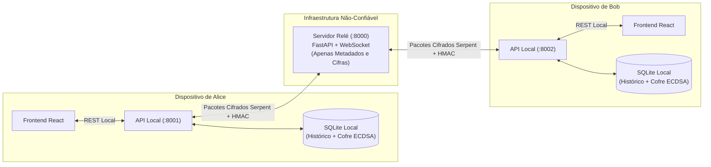

# 🔐 Shed — Mensageiro Criptografado de Ponta a Ponta (E2EE)

O **Shed** é uma aplicação de mensagens seguras de código aberto projetada com **Criptografia de Ponta a Ponta (E2EE)** de conhecimento zero (*Zero-Knowledge*). O sistema combina **ECDH + ECDSA (curva NIST SECP384R1)** para negociação autenticada de chaves e a cifra de bloco **Serpent (256 bits em modo CBC)** acoplada ao **HMAC-SHA256 (Encrypt-then-MAC)** para confidencialidade e integridade das mensagens.

---

## 🏗️ Arquitetura do Sistema

O projeto é dividido em três camadas independentes para garantir que **chaves privadas e textos em claro jamais saiam do dispositivo do usuário**:

```text
Shed/
├── server/                     # Servidor Relé Central (FastAPI + WebSocket + SQLite + RelayAuditor)
├── client/
│   ├── backend/                # Daemon/API Local do Usuário (FastAPI + Motor Criptográfico + SecurityAuditor)
│   └── frontend/               # Interface Web do Usuário (React 19 + Vite)
├── docs/                       # Documentação arquitetural detalhada
├── TODO.md                     # Quadro Kanban (DONE / DOING / TO-DO) detalhado
└── start-dev.ps1               # Script de inicialização rápida (Relé + 2 Clientes)
```



---

## 📊 Status do Projeto para a Equipe (DONE / DOING / TO-DO)

### ✅ 1. JÁ FOI FEITO (DONE — 100% Funcional e Testado)

#### 🔒 Motor Criptográfico (`client/backend/src/backend/`)
- **Derivação de Senha Dividida (*Split-Key Password Derivation*)** ([`crypto.py`](client/backend/src/backend/crypto.py)):
  - A senha mestre digitada pelo usuário **nunca é enviada ao Servidor Relé**.
  - O cliente aplica `HKDF-SHA256` localmente para dividir a senha em duas chaves de 256 bits matematicamente independentes:
    1. `local_storage_key`: Fica 100% na máquina local para cifrar a Chave Privada de Identidade no banco SQLite.
    2. `relay_login_secret`: Enviada ao Servidor Relé para autenticação com hash **Argon2**.
- **Chaves de Identidade ECDSA + Handshake ECDH Assinado (`SECP384R1`)** ([`crypto.py`](client/backend/src/backend/crypto.py) & [`session.py`](client/backend/src/backend/session.py)):
  - Cada conta gera um par de Chaves de Identidade permanente (`ECDSA`) no momento do registro.
  - A cada nova conversa, um par de chaves efêmero `ECDH` é gerado e **assinado digitalmente com ECDSA-SHA256**, impedindo ataques *Man-in-the-Middle* (MitM).
- **Fixação de Identidade TOFU (*Trust On First Use*)** ([`storage.py`](client/backend/src/backend/storage.py) & [`relay_client.py`](client/backend/src/backend/relay_client.py)):
  - No primeiro contato com um amigo, a API local fixa a Chave de Identidade pública dele na tabela `trusted_identities`. Se o servidor tentar trocar essa chave no futuro, a conexão é bloqueada imediatamente.
- **Cifragem Simétrica Serpent-CBC + Encrypt-then-MAC (`HMAC-SHA256`)** ([`serpent_enc.py`](client/backend/src/backend/serpent_enc.py)):
  - O segredo compartilhado do ECDH passa por `HKDF-SHA256` para derivar duas chaves independentes de 256 bits (`enc_key` e `mac_key`).
  - Cada mensagem recebe um IV aleatório de 16 bytes, é cifrada com **Serpent-CBC** e assinada com **HMAC-SHA256**:
    $$\text{Payload} = \underbrace{\text{IV}}_{16\text{B}} \;\parallel\; \underbrace{\text{Texto Cifrado (Serpent)}}_{N \times 16\text{B}} \;\parallel\; \underbrace{\text{HMAC-SHA256}}_{32\text{B}}$$
  - O destinatário valida o lacre HMAC **antes** de tentar decifrar qualquer byte.
- **Código de Segurança (*Safety Number*)** ([`session.py`](client/backend/src/backend/session.py)):
  - Impressão digital determinística de 6 blocos de 5 dígitos (`SHA-256` das chaves públicas ordenadas) para conferência fora de banda.

#### 🌐 Servidor Relé Central (`server/src/server/`)
- **Autenticação Argon2 + JWT (`OAuth2PasswordBearer`)** ([`auth.py`](server/src/server/auth.py) & [`__init__.py`](server/src/server/__init__.py)):
  - Registro (`POST /auth/register`), Login (`POST /auth/login` + botão **Authorize** do Swagger UI) e validação obrigatória de JWT no WebSocket (`/ws/{username}?token={jwt}`).
- **Descoberta de Contatos e Grafo de Amizades** ([`database.py`](server/src/server/database.py)):
  - Busca (`GET /users/search?q=...`), chave de identidade (`GET /users/{user}/identity-key`) e ciclo completo de amizades (`POST /friends/request/{user}`, `POST /friends/accept/{user}`, `POST /friends/reject/{user}`, `DELETE /friends/{user}`, `GET /friends`).
- **Roteamento *Friends-Only* e Fila Offline (*Store-and-Forward*)**:
  - Bloqueia mensagens entre usuários que não são amigos aceitos e armazena pacotes cifrados em `offline_messages` quando o destinatário está desconectado, entregando automaticamente no próximo login.
- **Auditoria Visual no Terminal do Relé (`RelayAuditor`)** ([`server/src/server/audit.py`](server/src/server/audit.py)):
  - Exibe em tempo real no terminal do servidor todas as autenticações, conexões WebSocket, trocas de chaves (`KEY_EXCHANGE` com chaves públicas e assinaturas ECDSA) e o raio-X dos pacotes cifrados (`IV` + `Ciphertext Serpent` + `HMAC-SHA256`), provando visualmente que o servidor **não tem acesso ao texto em claro**.

#### 🖥️ API Local Modularizada e Otimizada (`client/backend/src/backend/`)
- Código refatorado, sem duplicações e dividido por responsabilidade:
  - [`api.py`](client/backend/src/backend/api.py): Inicialização enxuta do FastAPI e ciclo de vida (`lifespan`).
  - [`routes.py`](client/backend/src/backend/routes.py): Rotas organizadas por domínio (`Autenticação`, `Amigos & Descoberta`, `Chat E2EE`), incluindo proxy completo de amizades (`request`, `accept`, `reject`, `DELETE`, `list`).
  - [`local_auth.py`](client/backend/src/backend/local_auth.py): Registro/login Split-Key, `OAuth2PasswordBearer` e modo offline (`POST /auth/logout`).
  - [`relay_client.py`](client/backend/src/backend/relay_client.py): Cliente WebSocket resiliente com tabela de despacho (`_ENVELOPE_HANDLERS`), helper HTTP centralizado (`relay_request`), validação TOFU e fila de mensagens aguardando handshake.
  - [`state.py`](client/backend/src/backend/state.py) & [`storage.py`](client/backend/src/backend/storage.py): Estado da sessão e persistência SQLite local com inicialização em cache (`data/<usuario>_history.db`).
  - [`audit.py`](client/backend/src/backend/audit.py): `SecurityAuditor` colorido por módulo (`[AUTH]`, `[ECDH]`, `[ECDSA]`, `[SERPENT]`, `[STORAGE]`, `[API]`) para demonstração passo a passo no terminal do cliente.
- **Correção na Camada de Serviços do Frontend**:
  - Corrigido o arquivo [`client/frontend/src/services/securityService.js`](client/frontend/src/services/securityService.js) para exportar corretamente `buscarSafetyNumber(contato)`.
- **Persistência de Sessões e Proteção contra *Replay Attack*** ([`session.py`](client/backend/src/backend/session.py), [`storage.py`](client/backend/src/backend/storage.py)):
  - Sessões ECDH são salvas cifradas no SQLite local e restauradas no login (sem novo handshake).
  - Cada mensagem leva `seq` + `ts` + `sid` dentro do payload autenticado; pacotes repetidos, fora de ordem, refletidos ou com timestamp futuro são descartados (`ReplayError`). Os contadores são persistidos.
- **Suíte de Testes Automatizados (24 testes passando)**:
  - `3` testes de integração no Servidor Relé + `21` testes no Cliente Local (incluindo [`test_replay_protection.py`](client/backend/tests/test_replay_protection.py)) (incluindo [`test_api_communication.py`](client/backend/tests/test_api_communication.py) que testa todo o fluxo ponta a ponta entre Relé, Alice e Bob).

---

### 🟡 2. SENDO FEITO (DOING — Em Andamento pela Equipe)

- Nenhuma tarefa em andamento no momento.

---

### 🔴 3. AINDA PRECISA SER FEITO (TO-DO — Próximos Passos)

- Nenhuma tarefa obrigatória pendente no backend. Ideias opcionais: rotação periódica da chave de sessão (*forward secrecy*), janela deslizante anti-replay e testes automatizados para o frontend.

---

## 🚀 Como Executar e Demonstrar o Projeto (Modo Apresentação)

### Opção 1: Inicialização com 1 Comando (Recomendado)
Na raiz do projeto, execute no PowerShell:
```powershell
.\start-dev.ps1
```

O script também inicia duas interfaces React independentes para permitir testar
uma conversa entre dois usuários na mesma máquina:

- Frontend 1: `http://127.0.0.1:5173` usa a API local `:8001`.
- Frontend 2: `http://127.0.0.1:5174` usa a API local `:8002`.

Abra uma janela para cada usuário. Não use a mesma porta do frontend para as
duas contas, pois cada usuário precisa manter seu próprio WebSocket conectado
ao relé.
Isso abrirá automaticamente **3 janelas de terminal** lado a lado (perfeito para mostrar à professora toda a movimentação criptográfica em tempo real):
- **Servidor Relé (`:8000`)**: Mostra os logs do `RelayAuditor` (`[AUTH]`, `[WS]`, `[HANDSHAKE]`, `[E2EE-MSG]` com `IV`, `Ciphertext` e `HMAC`, provando que o servidor só vê dados cifrados).
- **Cliente Local 1 (`:8001`)**: Mostra os logs do `SecurityAuditor` de Bob (geração de chaves, derivação HKDF, cifragem/decifragem Serpent).
- **Cliente Local 2 (`:8002`)**: Mostra os logs do `SecurityAuditor` de Alice.

Interfaces Swagger UI interativas:
- **Servidor Relé**: `http://127.0.0.1:8000/docs`
- **Cliente Local 1 (Bob)**: `http://127.0.0.1:8001/docs`
- **Cliente Local 2 (Alice)**: `http://127.0.0.1:8002/docs`

### Passo a Passo para Conversar pelo Swagger UI (`/docs`)
1. **Criar Contas e Logar**:
   - Em `http://127.0.0.1:8001/docs`: Execute `POST /auth/register` com `{"username": "bob", "password": "password123"}` e clique no botão verde **Authorize** no topo para logar como `bob`.
   - Em `http://127.0.0.1:8002/docs`: Execute `POST /auth/register` com `{"username": "alice", "password": "password123"}` e clique no botão verde **Authorize** no topo para logar como `alice`.
2. **Tornar-se Amigos**:
   - Na aba de **Alice (`:8002`)**: Execute `POST /friends/request/bob`.
   - Na aba de **Bob (`:8001`)**: Execute `POST /friends/accept/alice`.
3. **Iniciar Handshake e Trocar Mensagens Cifradas**:
   - Na aba de **Alice (`:8002`)**:
     - Execute `POST /chat/start/bob` (ou envie direto em `POST /chat/send/bob`, que negocia o handshake automaticamente!).
     - Confira o código de segurança em `GET /chat/safety-number/bob`.
   - Na aba de **Bob (`:8001`)**:
     - Consulte `GET /chat/history/alice` para ler a mensagem decifrada!
4. **Testar Mensagens Offline (*Store-and-Forward*)**:
   - Na aba de **Bob (`:8001`)**: Execute `POST /auth/logout` (Bob entra em modo Offline).
   - Na aba de **Alice (`:8002`)**: Envie mensagens em `POST /chat/send/bob` (o terminal do Relé mostrará o pacote sendo salvo na fila `OFFLINE`).
   - Na aba de **Bob (`:8001`)**: Faça login novamente em `POST /auth/login` e consulte `GET /chat/history/alice` — todas as mensagens enviadas enquanto Bob estava offline terão sido entregues e decifradas!

### Executando os Testes Automatizados (`pytest`)
```powershell
# Testes do Servidor Relé (3 testes: Registro/Login, Amizades e Fila Offline WebSocket)
cd server
uv run pytest -v

# Testes do Cliente Local (21 testes: ECDH, ECDSA, Split-Key, TOFU, Serpent, HMAC, Anti-Replay, MitM e Fluxo Completo da API)
cd ../client/backend
uv run pytest -v

# Para ver o log visual completo (Cliente + Relé) da comunicação ponta a ponta no terminal:
uv run pytest -s tests/test_api_communication.py
```

---

📚 **Documentação Adicional**:
- [Como o Shed Funciona por Dentro (Guia Criptográfico Detalhado)](docs/COMO_FUNCIONA.md)
- [Roteiro de Gravação do Vídeo](ROTEIRO_VIDEO.md)
- [Arquitetura de Autenticação, Descoberta e Gestão de Amigos](docs/AUTHENTICATION_AND_DISCOVERY.md)
- [Quadro Kanban (DONE / DOING / TO-DO) e Lista de Tarefas](TODO.md)
