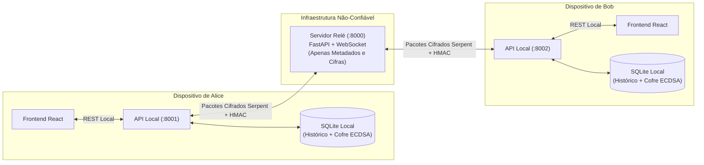

# 🔐 Shed — Mensageiro Criptografado de Ponta a Ponta (E2EE)

O **Shed** é uma aplicação de mensagens seguras de código aberto projetada com **Criptografia de Ponta a Ponta (E2EE)** de conhecimento zero (*Zero-Knowledge*). O sistema combina **ECDH + ECDSA (curva NIST SECP384R1)** para negociação autenticada de chaves e a cifra de bloco **Serpent (256 bits em modo CBC)** acoplada ao **HMAC-SHA256 (Encrypt-then-MAC)** para confidencialidade e integridade das mensagens.

---

## 🏗️ Arquitetura do Sistema

O projeto é dividido em três camadas independentes para garantir que **chaves privadas e textos em claro jamais saiam do dispositivo do usuário**:

```text
Shed/
├── server/                     # Servidor Relé Central (FastAPI + WebSocket + SQLite)
├── client/
│   ├── backend/                # Daemon/API Local do Usuário (FastAPI + Motor Criptográfico + SQLite)
│   └── frontend/               # Interface Web do Usuário (React 19 + Vite)
├── docs/                       # Documentação arquitetural detalhada
├── TODO.md                     # Quadro Kanban (DO / DOING / DONE) e Roadmap
└── start-dev.ps1               # Script de inicialização rápida (Relé + 2 Clientes)
```



---

## ✅ O Que Já Está Funcionando (100% Operacional e Testado)

### 1. Motor Criptográfico (`client/backend/src/backend/`)
- **Derivação de Senha Dividida (*Split-Key Password Derivation*)**:
  - A senha mestre digitada pelo usuário **nunca é enviada ao Servidor Relé**.
  - O cliente aplica `HKDF-SHA256` localmente para dividir a senha em duas chaves de 256 bits matematicamente independentes:
    1. `local_storage_key`: Fica 100% na máquina local para cifrar a Chave Privada de Identidade no banco SQLite.
    2. `relay_login_secret`: Enviada ao Servidor Relé para autenticação com hash **Argon2**.
- **Chaves de Identidade ECDSA + Handshake ECDH Assinado (`SECP384R1`)**:
  - Cada conta gera um par de Chaves de Identidade permanente (`ECDSA`) no momento do registro.
  - A cada nova conversa, um par de chaves efêmero `ECDH` é gerado e **assinado digitalmente com ECDSA-SHA256**, impedindo que o Servidor Relé ou um invasor substitua chaves públicas na rede (*Man-in-the-Middle*).
- **Fixação de Identidade TOFU (*Trust On First Use*)**:
  - No primeiro contato com um amigo, a API local fixa a Chave de Identidade pública dele na tabela `trusted_identities`. Se o servidor tentar trocar essa chave no futuro, a conexão é bloqueada imediatamente.
- **Cifragem Simétrica Serpent-CBC + Encrypt-then-MAC (`HMAC-SHA256`)**:
  - O segredo compartilhado do ECDH passa por `HKDF-SHA256` para derivar duas chaves independentes de 256 bits (`enc_key` e `mac_key`).
  - Cada mensagem recebe um IV aleatório de 16 bytes, é cifrada com **Serpent-CBC** e assinada com **HMAC-SHA256**:
    $$\text{Payload} = \underbrace{\text{IV}}_{16\text{B}} \;\parallel\; \underbrace{\text{Texto Cifrado (Serpent)}}_{N \times 16\text{B}} \;\parallel\; \underbrace{\text{HMAC-SHA256}}_{32\text{B}}$$
  - O destinatário valida o lacre HMAC **antes** de tentar decifrar qualquer byte.
- **Código de Segurança (*Safety Number*)**:
  - Gera uma impressão digital determinística de 6 blocos de 5 dígitos (`SHA-256` das chaves públicas ordenadas) para conferência fora de banda entre os participantes.

### 2. Servidor Relé Central (`server/src/server/`)
- **Autenticação Argon2 + JWT (`OAuth2PasswordBearer`)**:
  - Registro (`POST /auth/register`) e Login (`POST /auth/login` e botão **Authorize** do Swagger UI).
  - Proteção do canal WebSocket (`/ws/{username}?token={jwt}`) contra falsificação de identidade.
- **Descoberta de Contatos e Grafo de Amizades**:
  - Busca de usuários (`GET /users/search?q=...`) e consulta de chave pública (`GET /users/{user}/identity-key`).
  - Ciclo completo de amizades: enviar convite (`POST /friends/request/{user}`), aceitar (`POST /friends/accept/{user}`), recusar (`POST /friends/reject/{user}`), remover (`DELETE /friends/{user}`) e listar (`GET /friends`).
- **Roteamento *Friends-Only***:
  - Bloqueia automaticamente tentativas de envio de handshakes ou mensagens entre usuários que ainda não são amigos aceitos.
- **Fila de Mensagens Offline (*Store-and-Forward*)**:
  - Se o destinatário estiver desconectado, o relé armazena o envelope cifrado na tabela `offline_messages` e entrega automaticamente assim que ele se conectar.

### 3. API Local Modular (`client/backend/src/backend/`)
- Organizada em módulos independentes:
  - [`api.py`](client/backend/src/backend/api.py): Inicialização FastAPI e ciclo de vida.
  - [`routes.py`](client/backend/src/backend/routes.py): Rotas separadas por domínio (`Autenticação`, `Amigos & Descoberta`, `Chat E2EE`).
  - [`local_auth.py`](client/backend/src/backend/local_auth.py): Registro/login Split-Key, `OAuth2PasswordBearer` e modo offline (`POST /auth/logout`).
  - [`relay_client.py`](client/backend/src/backend/relay_client.py): Cliente WebSocket em background, validação TOFU e fila de mensagens aguardando término de handshake.
  - [`state.py`](client/backend/src/backend/state.py) & [`storage.py`](client/backend/src/backend/storage.py): Estado da sessão e persistência SQLite local (`data/<usuario>_history.db`).

---

## 🚀 Como Executar e Testar o Projeto Agora

### Opção 1: Inicialização com 1 Comando (Recomendado)
Na raiz do projeto, execute no PowerShell:
```powershell
.\start-dev.ps1
```
Isso abrirá automaticamente 3 terminais:
- **Servidor Relé**: `http://127.0.0.1:8000/docs`
- **Cliente Local 1**: `http://127.0.0.1:8001/docs`
- **Cliente Local 2**: `http://127.0.0.1:8002/docs`

### Opção 2: Inicialização Manual
```powershell
# Terminal 1 - Servidor Relé (Porta 8000)
cd server
uv sync
uv run uvicorn server:app --reload --host 127.0.0.1 --port 8000

# Terminal 2 - Cliente Local 1 (Porta 8001)
cd client/backend
uv sync
uv run uvicorn backend.api:app --reload --host 127.0.0.1 --port 8001

# Terminal 3 - Cliente Local 2 (Porta 8002)
cd client/backend
uv run uvicorn backend.api:app --reload --host 127.0.0.1 --port 8002
```

### Passo a Passo para Conversar pelo Swagger UI (`/docs`)
1. **Criar Contas e Logar**:
   - Em `http://127.0.0.1:8001/docs`: Execute `POST /auth/register` com `{"username": "bob", "password": "password123"}` e clique no botão verde **Authorize** no topo para logar como `bob`.
   - Em `http://127.0.0.1:8002/docs`: Execute `POST /auth/register` com `{"username": "alice", "password": "password123"}` e clique no botão verde **Authorize** no topo para logar como `alice`.
2. **Tornar-se Amigos**:
   - Na aba de **Alice (`:8002`)**: Execute `POST /friends/request/bob`.
   - Na aba de **Bob (`:8001`)**: Execute `POST /friends/accept/alice`.
3. **Iniciar Handshake e Trocar Mensagens Cifradas**:
   - Na aba de **Alice (`:8002`)**:
     - Execute `POST /chat/start/bob` (handshake ECDH assinado com ECDSA).
     - Confira o código em `GET /chat/safety-number/bob`.
     - Envie uma mensagem em `POST /chat/send/bob`.
   - Na aba de **Bob (`:8001`)**:
     - Consulte `GET /chat/history/alice` para ler a mensagem decifrada!
4. **Testar Mensagens Offline (*Store-and-Forward*)**:
   - Na aba de **Bob (`:8001`)**: Execute `POST /auth/logout` (Bob entra em modo Offline).
   - Na aba de **Alice (`:8002`)**: Envie mensagens em `POST /chat/send/bob` (o Relé guardará os pacotes cifrados).
   - Na aba de **Bob (`:8001`)**: Faça login novamente em `POST /auth/login` (ou botão **Authorize**) e consulte `GET /chat/history/alice` — todas as mensagens enviadas enquanto Bob estava offline estarão lá!

### Executando os Testes Automatizados (`pytest`)
```powershell
# Testes do Servidor Relé (Registro, Login, Amizades, Auth WebSocket e Fila Offline)
cd server
uv run pytest -v

# Testes do Cliente Local (ECDH, ECDSA, Split-Key, TOFU, Serpent, HMAC, MitM e Comunicação da API)
cd ../client/backend
uv run pytest -v

# Para ver o log detalhado passo a passo da comunicação da API no terminal:
uv run pytest -s tests/test_api_communication.py
```

---

## 🛠️ O Que Falta Fazer Para o App Ficar 100% Completo

Embora todo o **Backend Local** e o **Servidor Relé** já estejam funcionais e testados, os seguintes itens precisam ser concluídos para finalizar a aplicação:

### 1. Corrigir e Completar a Camada de Serviços do Frontend (`client/frontend/src/services/`)
- [ ] **Corrigir `securityService.js`**: O arquivo [`client/frontend/src/services/securityService.js`](client/frontend/src/services/securityService.js) atualmente duplica a função `buscarHistorico` por engano em vez de exportar `buscarSafetyNumber(contato)`.
- [ ] **Adicionar Serviços de Autenticação e Amizades**: Criar `authService.js` (`/auth/register`, `/auth/login`, `/auth/logout`) e `friendsService.js` (`/users/search`, `/friends`, `/friends/request`, `/friends/accept`) para consumir as novas rotas da API local.

### 2. Construir a Interface Gráfica em React (`client/frontend/src/`)
- [ ] **Substituir o template padrão do Vite (`App.jsx`)**: Atualmente [`App.jsx`](client/frontend/src/App.jsx) ainda contém a tela inicial de contador do Vite.
- [ ] **Tela de Login e Cadastro**: Formulário para autenticar na API local.
- [ ] **Painel de Contatos e Amizades**: Barra lateral com lista de amigos, busca de usuários (`GET /users/search`) e botões para aceitar solicitações pendentes.
- [ ] **Janela de Conversa (Chat)**: Listagem das mensagens (`GET /chat/history/{contato}`), campo de envio (`POST /chat/send/{contato}`) e modal exibindo o **Safety Number** (`GET /chat/safety-number/{contato}`).

### 3. Notificações em Tempo Real da API Local para o React
- [ ] **Server-Sent Events (SSE) ou WebSocket Local**: Atualmente, quando uma mensagem chega do Relé, a API local decifra e salva no SQLite, mas o React precisa consultar `GET /chat/history/{contato}` (polling) para atualizar a tela. Adicionar uma rota `GET /chat/events` (SSE) na API local permitirá atualizar a tela do React instantaneamente.

### 4. Persistência de Sessão e Proteção contra *Replay Attack* (Melhorias Futuras)
- [ ] **Persistência de Sessões Simétricas**: Salvar as chaves de sessão ativas (`active_sessions`) cifradas no SQLite local para que, mesmo se o processo Python local for fechado e reaberto, não seja necessário renegociar o handshake ECDH.
- [ ] **Contador de Sequência (*Anti-Replay*)**: Incluir um número de sequência incremental dentro do payload cifrado para impedir que um atacante reenvie pacotes antigos capturados na rede.

---

📚 **Documentação Adicional**:
- [Arquitetura de Autenticação, Descoberta e Gestão de Amigos](docs/AUTHENTICATION_AND_DISCOVERY.md)
- [Quadro Kanban (DO / DOING / DONE) e Lista de Tarefas](TODO.md)
