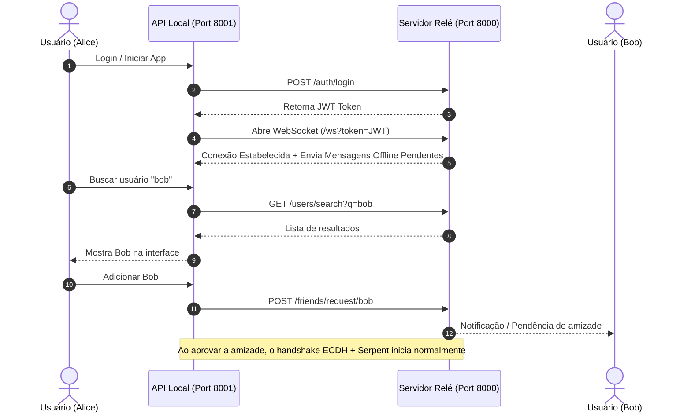

# Arquitetura de Autenticação, Descoberta e Gestão de Amigos (Shed)

Este documento descreve a recomendação arquitetural e o modelo de segurança para implementar autenticação, busca de contatos e gerenciamento de amizades no projeto **Shed**, preservando a garantia de Criptografia de Ponta a Ponta (E2EE).

---

## 1. Resumo Executivo & Decisão Arquitetural

**Pergunta Central**: *É seguro utilizar o Servidor Relé (`server/`) para autenticação de contas, busca de pessoas e solicitação de amizade?*

**Resposta**: **Sim, é seguro e é a abordagem padrão recomendada na indústria** (utilizada por Signal, WhatsApp e Matrix).

Atualmente, o relé do Shed possui uma vulnerabilidade de impersonação: qualquer pessoa pode se conectar em `ws://127.0.0.1:8000/ws/alice` e interceptar ou derrubar a conexão de Alice. Centralizar a autenticação no relé resolve esse problema sem enfraquecer o E2EE, desde que seja respeitada a **separação estrita de responsabilidades**.

---

## 2. Separação de Responsabilidades (Quem Faz o Quê)

O princípio fundamental de um sistema E2EE é a separação entre a **identidade/roteamento** (metadados) e o **conteúdo** (criptografia simétrica):

```
+-------------------------------------------------------------------------+
|                              SERVIDOR RELÉ                              |
|                       (Metadados & Infraestrutura)                      |
|                                                                         |
|  - Cadastro e login de contas (Username + Senha com Argon2/bcrypt)       |
|  - Emissão de tokens de autenticação (JWT)                              |
|  - Diretório de Chaves Públicas de Identidade                           |
|  - Busca de usuários e gestão de amizades (solicitações/bloqueios)     |
|  - Roteamento autenticado de envelopes WebSocket                        |
|  - Fila de mensagens offline (Store-and-Forward)                        |
|                                                                         |
|  * O relé NUNCA tem acesso às chaves privadas ou mensagens decifradas. *|
+-------------------------------------------------------------------------+
                                    |
                    Envelopes Cifrados (Texto Puro Oculto)
                                    |
                                    v
+-------------------------------------------------------------------------+
|                              CLIENTE LOCAL                              |
|                       (Segurança E2EE & Conteúdo)                       |
|                                                                         |
|  - Geração e guarda das Chaves Privadas (ECDH / SECP384R1)              |
|  - Derivação de segredos via HKDF-SHA256                                |
|  - Cifragem/Decifragem Serpent em modo CBC                              |
|  - Geração e validação de autenticidade via HMAC-SHA256                 |
|  - Cálculo do Safety Number (para conferência contra MitM)              |
|  - Armazenamento local do histórico decifrado (SQLite)                  |
+-------------------------------------------------------------------------+
```

---

## 3. Modelo de Ameaças & Medidas de Segurança

Ao adicionar CRUD de usuários no servidor central, quatro riscos principais devem ser endereçados:

### Risco 1: Impersonação e Sequestro de Conexão
* **Ameaça**: Atacante conecta como `bob` e recebe mensagens destinadas a Bob.
* **Solução**: O endpoint WebSocket (`/ws`) passa a exigir um token JWT assinado ou desafio de chave pública gerado no login. Apenas conexões autenticadas abrem canais de recebimento.

### Risco 2: Servidor Malicioso ou Ataque MitM (Substituição de Chave)
* **Ameaça**: Um administrador malicioso no relé substitui a chave pública de Bob pela chave do atacante durante o handshake inicial.
* **Solução**: 
  1. Cada conta cadastra uma **Chave de Identidade Pública** permanente no registro.
  2. O **Safety Number** (já implementado em `SecureSession.get_safety_number()`) permite que Alice e Bob verifiquem por canal externo (voz/QR Code) se estão utilizando as chaves legítimas. Se o relé adulterar as chaves, os números obrigatoriamente divergem.

### Risco 3: Vazamento do Grafo Social (Metadados)
* **Ameaça**: O servidor conhece quem é amigo de quem e os horários das trocas de mensagens.
* **Solução**:
  - *Abordagem Prática (Recomendada para o Shed)*: O servidor gerencia o status de amizade (`PENDING`, `ACCEPTED`), facilitando busca e envio de solicitações.
  - *Abordagem Minimalista*: O servidor mantém apenas o registro de usuários e busca por nome; a lista de amigos aprovados é mantida exclusivamente no SQLite local do cliente (`LocalStorage`), enviando solicitações como payloads E2EE cifrados.

### Risco 4: Usuário Destinatário Desconectado
* **Ameaça**: Atualmente, se o destinatário não estiver com o WebSocket aberto no momento exato do envio, a mensagem é descartada silenciosamente.
* **Solução**: O servidor deve armazenar temporariamente o envelope JSON cifrado em uma fila offline até que o usuário autenticado se conecte.

---

## 4. Esquema de Banco de Dados Sugerido para o Servidor (`server/`)

O servidor pode adotar SQLite local ou PostgreSQL com as seguintes tabelas:

```sql
-- 1. Usuários e Chaves de Identidade
CREATE TABLE users (
    id INTEGER PRIMARY KEY AUTOINCREMENT,
    username TEXT UNIQUE NOT NULL,
    password_hash TEXT NOT NULL,          -- Hash com Argon2 ou bcrypt
    public_identity_key TEXT,             -- Chave pública de longo prazo em PEM
    created_at DATETIME DEFAULT CURRENT_TIMESTAMP,
    last_seen DATETIME DEFAULT CURRENT_TIMESTAMP
);

-- 2. Gestão de Amizades e Solicitações
CREATE TABLE friendships (
    id INTEGER PRIMARY KEY AUTOINCREMENT,
    requester_id INTEGER NOT NULL REFERENCES users(id),
    addressee_id INTEGER NOT NULL REFERENCES users(id),
    status TEXT CHECK(status IN ('PENDING', 'ACCEPTED', 'REJECTED', 'BLOCKED')) DEFAULT 'PENDING',
    created_at DATETIME DEFAULT CURRENT_TIMESTAMP,
    updated_at DATETIME DEFAULT CURRENT_TIMESTAMP,
    UNIQUE(requester_id, addressee_id)
);

-- 3. Mensagens Offline (Store-and-Forward)
CREATE TABLE offline_messages (
    id INTEGER PRIMARY KEY AUTOINCREMENT,
    recipient_username TEXT NOT NULL,
    sender_username TEXT NOT NULL,
    envelope_json TEXT NOT NULL,          -- Envelope JSON contendo o payload cifrado
    created_at DATETIME DEFAULT CURRENT_TIMESTAMP
);
```

---

## 5. Especificação de Endpoints da API do Servidor

### Autenticação
* `POST /auth/register`
  - **Body**: `{ "username": "alice", "password": "...", "public_identity_key": "..." }`
  - Cria o usuário, gera o hash da senha e salva a chave de identidade.
* `POST /auth/login`
  - **Body**: `{ "username": "alice", "password": "..." }`
  - **Retorno**: `{ "access_token": "<jwt_token>", "token_type": "bearer" }`

### Busca de Usuários & Amizades
* `GET /users/search?q={termo}`
  - Retorna usuários correspondentes (ex: `[{ "username": "bob", "public_identity_key": "..." }]`).
* `POST /friends/request/{username}`
  - Cria solicitação de amizade com status `PENDING`.
* `POST /friends/accept/{username}`
  - Atualiza solicitação para `ACCEPTED`.
* `POST /friends/reject/{username}`
  - Atualiza para `REJECTED` ou remove.
* `GET /friends`
  - Lista amigos confirmados e solicitações pendentes.

### WebSocket Autenticado
* `GET /ws?token={access_token}`
  - Valida o token JWT.
  - Vincula o WebSocket ao `username` verificado no payload do token.
  - Entrega imediatamente mensagens pendentes da tabela `offline_messages`.

---

## 6. Fluxo de Execução com o Cliente Local



---

## 7. Roteiro de Implementação Sugerido

1. **Fase 1 (Servidor - Banco & Auth)**:
   - Adicionar `passlib[argon2]` ou `bcrypt` e `pyjwt` às dependências do `server/pyproject.toml`.
   - Criar banco SQLite e modelos de dados para `User`, `Friendship` e `OfflineMessage`.
   - Implementar endpoints `/auth/register` e `/auth/login`.

2. **Fase 2 (Servidor - Proteção do WebSocket)**:
   - Modificar `/ws/{username}` para validar o token JWT emitido.
   - Implementar salvamento de envelopes na tabela `offline_messages` caso o destinatário não esteja conectado.

3. **Fase 3 (Servidor - Gestão de Amigos)**:
   - Implementar endpoints de busca e gerenciamento de solicitações de amizade.

4. **Fase 4 (Cliente Local)**:
   - Atualizar `client/backend/src/backend/api.py` para armazenar o token JWT de sessão.
   - Atualizar a rotina de reconexão do WebSocket (`listen_to_relay`) passando o token.
   - Expor rotas de proxy na API local para que o React possa chamar a busca e o gerenciamento de amigos.
