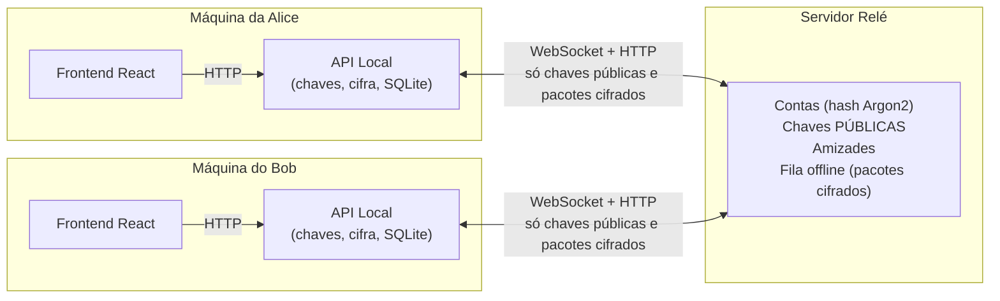
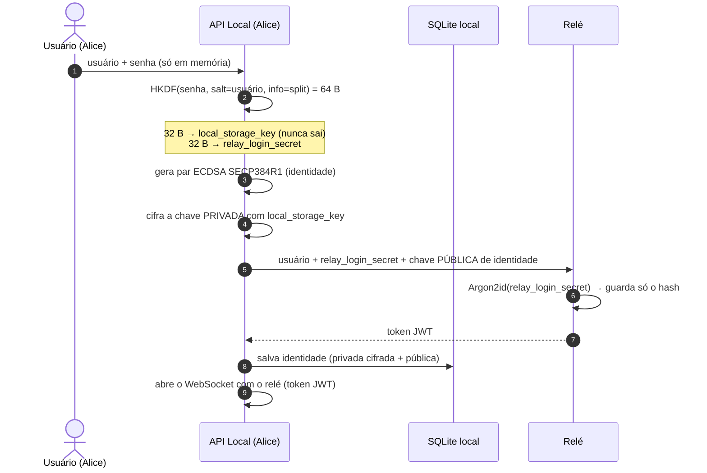
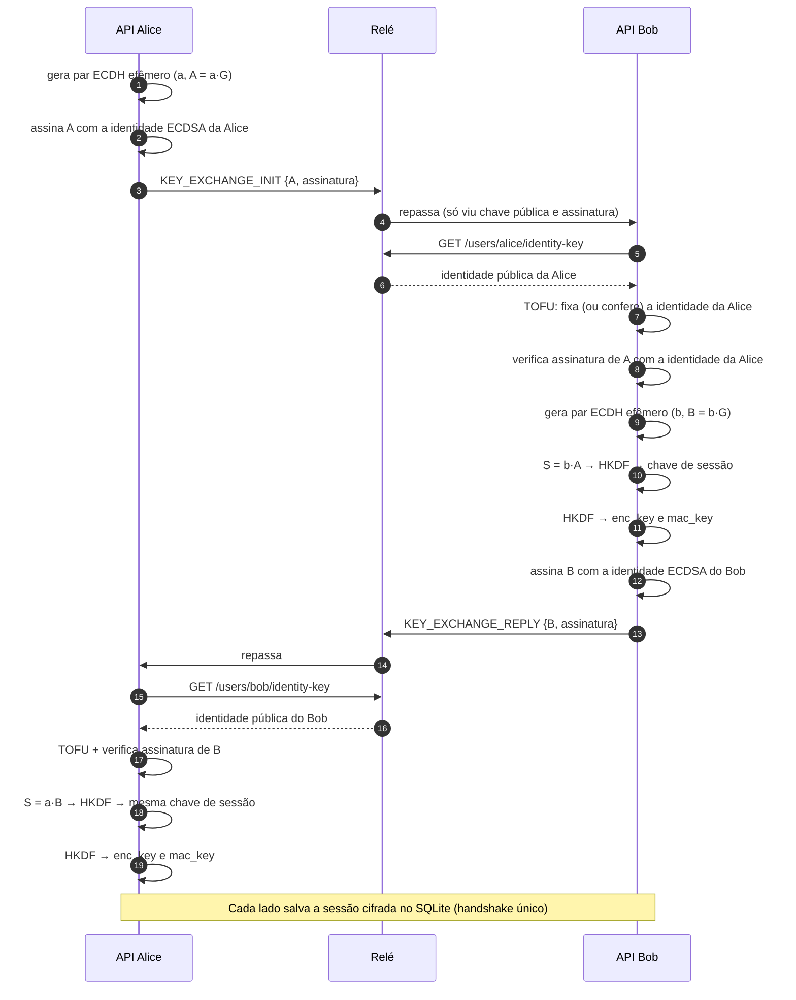
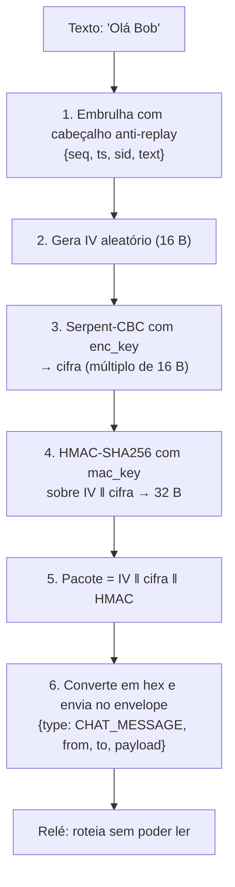
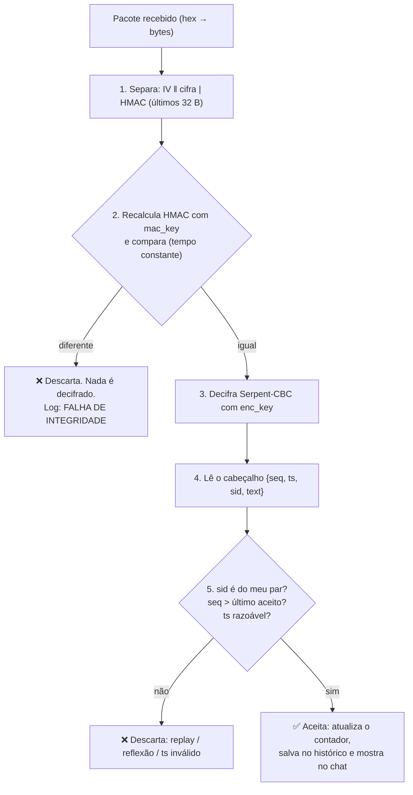

# 🔐 Como o Shed funciona por dentro

Guia para **entender e explicar** todo o processo criptográfico do Shed: da senha do usuário até o pacote cifrado que atravessa o relé. Leia na ordem: cada seção usa conceitos da anterior.

> Notação usada: `‖` = concatenação de bytes · `⊕` = XOR · `H(x)` = SHA-256 de `x` · `d` = chave privada · `Q` = chave pública · `G` = ponto base da curva.

## Sumário
1. [Visão geral: quem guarda o quê](#1-visão-geral-quem-guarda-o-quê)
2. [Ferramentas matemáticas](#2-ferramentas-matemáticas)
   - [2.1 Hash SHA-256](#21-hash-sha-256)
   - [2.2 HMAC-SHA256](#22-hmac-sha256)
   - [2.3 HKDF](#23-hkdf-derivação-de-chaves)
   - [2.4 Curva elíptica SECP384R1](#24-curva-elíptica-secp384r1-nist-p-384)
   - [2.5 ECDH](#25-ecdh-acordo-de-chaves)
   - [2.6 ECDSA](#26-ecdsa-assinatura-digital)
   - [2.7 Serpent e o modo CBC](#27-serpent-e-o-modo-cbc)
   - [2.8 Encrypt-then-MAC](#28-encrypt-then-mac)
3. [A sequência completa, passo a passo](#3-a-sequência-completa-passo-a-passo)
   - [Etapa A – Cadastro](#etapa-a--cadastro-split-key-e-identidade)
   - [Etapa B – Amizade](#etapa-b--amizade)
   - [Etapa C – Handshake](#etapa-c--handshake-ecdh-assinado-com-ecdsa)
   - [Etapa D – Safety Number](#etapa-d--safety-number)
   - [Etapa E – Envio de uma mensagem](#etapa-e--envio-de-uma-mensagem)
   - [Etapa F – Recebimento](#etapa-f--recebimento-de-uma-mensagem)
   - [Etapa G – Mensagem offline](#etapa-g--mensagem-offline-store-and-forward)
   - [Etapa H – Reiniciar e continuar](#etapa-h--reiniciar-o-backend-e-continuar)
4. [Anatomia do pacote que passa pelo relé](#4-anatomia-do-pacote-que-passa-pelo-relé)
5. [Quem consegue ver o quê](#5-quem-consegue-ver-o-quê)
6. [Ataques e defesas](#6-ataques-e-defesas)
7. [Onde está cada coisa no código](#7-onde-está-cada-coisa-no-código)
8. [Limitações honestas](#8-limitações-honestas)
9. [Perguntas e respostas para a apresentação](#9-perguntas-e-respostas-para-a-apresentação)

---

## 1. Visão geral: quem guarda o quê



**Regra de ouro:** tudo o que é secreto (senha, chaves privadas, chave de sessão, texto em claro) existe **apenas** dentro da API Local de cada usuário. O relé só enxerga chaves públicas, assinaturas, hashes e pacotes cifrados.

### Todas as chaves do sistema

| Chave | Algoritmo | Tamanho | Onde nasce | Onde fica | O relé vê? |
|---|---|---|---|---|---|
| `local_storage_key` | HKDF-SHA256 da senha | 256 bits | API Local (login/cadastro) | Só na **memória** | ❌ Nunca |
| `relay_login_secret` | HKDF-SHA256 da senha | 256 bits | API Local | Enviada ao relé; lá fica só o **hash Argon2** | ⚠️ Só no login (e só o hash fica guardado) |
| Identidade privada | ECDSA SECP384R1 | 384 bits | API Local (cadastro) | SQLite local, **cifrada** com `local_storage_key` | ❌ Nunca |
| Identidade pública | ECDSA SECP384R1 | 384 bits | API Local | SQLite local + **relé** | ✅ Sim (é pública) |
| Efêmera privada | ECDH SECP384R1 | 384 bits | API Local (a cada handshake) | Só na memória, durante o handshake | ❌ Nunca |
| Efêmera pública | ECDH SECP384R1 | 384 bits | API Local | Trafega no handshake (assinada) | ✅ Sim (é pública) |
| Chave de sessão | HKDF-SHA256 do segredo ECDH | 256 bits | **Calculada** nos dois lados | Memória + SQLite **cifrada** com `local_storage_key` | ❌ Nunca |
| `enc_key` | HKDF-SHA256 da chave de sessão | 256 bits | Calculada nos dois lados | Memória | ❌ Nunca |
| `mac_key` | HKDF-SHA256 da chave de sessão | 256 bits | Calculada nos dois lados | Memória | ❌ Nunca |

---

## 2. Ferramentas matemáticas

### 2.1 Hash SHA-256
Função que transforma qualquer dado numa "impressão digital" de **32 bytes (256 bits)**.
- **Determinística:** mesma entrada, mesma saída.
- **Unidirecional:** não dá para recuperar a entrada a partir da saída.
- **Efeito avalanche:** mudar **1 bit** da entrada muda cerca de metade dos bits da saída.
- **Resistente a colisões:** é inviável achar duas entradas diferentes com o mesmo hash.

No Shed, o SHA-256 está dentro do HMAC, do HKDF, do ECDSA, do Safety Number e dos *fingerprints* dos logs.

> **Fingerprint** nos logs = primeiros 8 bytes de `SHA-256(chave)`, em hexadecimal agrupado (ex.: `A1B2 C3D4 E5F6 0718`). Permite comparar chaves entre terminais sem expor a chave.

### 2.2 HMAC-SHA256
**Para que serve:** provar que uma mensagem **não foi alterada** (integridade) e que **foi criada por quem conhece a chave secreta** (autenticidade). Um hash comum não serve, porque qualquer um pode recalcular um hash; no HMAC é preciso a chave.

**Definição (RFC 2104):**

$$\text{HMAC}(K, m) = H\Big( (K' \oplus \text{opad}) \;\|\; H\big( (K' \oplus \text{ipad}) \;\|\; m \big) \Big)$$

- `K'` = a chave preenchida com zeros até o tamanho do bloco do SHA-256 (**64 bytes**). Se a chave for maior que 64 bytes, ela é "hasheada" antes.
- `ipad` = o byte `0x36` repetido 64 vezes; `opad` = o byte `0x5c` repetido 64 vezes.
- Resultado: **32 bytes**.

**Passo a passo:**
1. Preencha a chave até 64 bytes (`K'`).
2. Calcule `K' ⊕ ipad` e concatene com a mensagem `m`; faça o SHA-256 disso → hash **interno**.
3. Calcule `K' ⊕ opad`, concatene com o hash interno e faça o SHA-256 → **HMAC final**.

**Por que duas camadas?** Um SHA-256 simples do tipo `H(K ‖ m)` sofre *length extension attack* (o atacante estende a mensagem sem conhecer `K`). A estrutura aninhada do HMAC elimina esse problema.

**Verificação:** o receptor recalcula o HMAC com a mesma chave e compara com o recebido, usando **comparação em tempo constante** (para não vazar informação pelo tempo de resposta). No Shed isso é feito por `hmac.HMAC(...).verify(...)` da biblioteca `cryptography`. Se qualquer bit do pacote for alterado, os HMACs são completamente diferentes e a mensagem é descartada.

**Exemplo mental:** Alice e Bob compartilham a `mac_key`. Alice envia `pacote` e `HMAC(mac_key, pacote)`. Um atacante que altera 1 bit do `pacote` não consegue gerar o HMAC correto, porque não tem a `mac_key`.

### 2.3 HKDF (derivação de chaves)
**Para que serve:** transformar um segredo (senha, ou o segredo bruto do ECDH) em **chaves criptográficas fortes e independentes**. O segredo do ECDH tem estrutura matemática (é uma coordenada de um ponto), então não deve ser usado direto como chave.

**Duas fases (RFC 5869), ambas baseadas em HMAC-SHA256:**
1. **Extract:** `PRK = HMAC(salt, IKM)` concentra a "aleatoriedade" do segredo de entrada (`IKM`) numa chave de 32 bytes. Se `salt=None`, usa-se uma sequência de zeros.
2. **Expand:** gera quantos bytes forem necessários:

$$T(i) = \text{HMAC}\big(PRK,\; T(i-1) \,\|\, \text{info} \,\|\, i\big),\qquad \text{saída} = T(1)\,\|\,T(2)\,\|\cdots$$

O parâmetro `info` é um **rótulo de contexto**: chaves derivadas com `info` diferentes são independentes entre si.

**Os 3 usos do HKDF no Shed:**

| Uso | `salt` | `info` | Saída | Resultado |
|---|---|---|---|---|
| Split-Key da senha | nome do usuário | `shed-master-password-split` | 64 bytes | 32 B → `local_storage_key`, 32 B → `relay_login_secret` |
| Chave de sessão | nenhum | `shed-session-key` | 32 bytes | Chave de sessão |
| Chaves filhas | nenhum | `shed-enc-mac` | 64 bytes | 32 B → `enc_key`, 32 B → `mac_key` |

> ⚠️ O HKDF é **rápido de propósito**. Ele separa chaves, mas **não protege senhas fracas contra tentativa e erro**; para isso se usam KDFs lentos (Argon2, scrypt). No Shed, o **relé** guarda o hash **Argon2id** do `relay_login_secret`; já a `local_storage_key` depende da força da senha do usuário. Veja [Limitações](#8-limitações-honestas).

### 2.4 Curva elíptica SECP384R1 (NIST P-384)

#### A equação
Uma curva elíptica sobre um corpo finito é o conjunto dos pontos `(x, y)` que satisfazem:

$$y^2 \equiv x^3 + a\,x + b \pmod p$$

Para a **SECP384R1** (também chamada **NIST P-384**):

| Parâmetro | Valor |
|---|---|
| Primo `p` | $2^{384} - 2^{128} - 2^{96} + 2^{32} - 1$ |
| `a` | $-3$ (isto é, `p − 3`) |
| `b` | `b3312fa7e23ee7e4988e056be3f82d19181d9c6efe8141120314088f5013875ac656398d8a2ed19d2a85c8edd3ec2aef` (hex) |
| Ponto base `G` | Um ponto fixo e público da curva (coordenadas definidas no padrão NIST) |
| Ordem `n` | Quantidade de múltiplos distintos de `G`; um número primo de **384 bits** |

Como a curva é sobre um corpo finito (mod `p`), os pontos formam uma "nuvem" discreta, não uma curva contínua como as figuras de livros. Mas as **regras algébricas** são as mesmas.

#### A operação de grupo (soma de pontos)
Dados dois pontos `P` e `Q` da curva, define-se `P + Q` (geometricamente: a reta por `P` e `Q` cruza a curva num terceiro ponto; reflete-se no eixo x). Algebricamente, para `P = (x₁, y₁)` e `Q = (x₂, y₂)`:

- Se `P ≠ Q`: inclinação $\lambda = \dfrac{y_2 - y_1}{x_2 - x_1} \bmod p$
- Se `P = Q` (dobrar): $\lambda = \dfrac{3x_1^2 + a}{2y_1} \bmod p$
- Resultado: $x_3 = \lambda^2 - x_1 - x_2$ e $y_3 = \lambda\,(x_1 - x_3) - y_1$ (tudo mod `p`).

#### Multiplicação escalar e o problema difícil
Somar `P` a si mesmo `k` vezes dá `k·P`. Isso é **fácil de calcular** (algoritmo "dobra e soma", poucas centenas de operações para `k` de 384 bits), mas **inviável de inverter**: dado `Q = k·G`, descobrir `k` é o **problema do logaritmo discreto em curvas elípticas (ECDLP)**. Para P-384, o melhor ataque conhecido exige cerca de $2^{192}$ operações: fora do alcance de qualquer computador clássico.

> **Chave privada** = um número inteiro aleatório `d` entre `1` e `n − 1`.
> **Chave pública** = o ponto `Q = d·G`.
> Todo o ECDH e o ECDSA se apoiam nessa assimetria: de `d` se chega a `Q` facilmente; de `Q` a `d`, não.

#### 🧮 Exemplo de brinquedo (para os slides)
Curva pequena: $y^2 = x^3 + 2x + 2 \pmod{17}$, ponto base $G = (5, 1)$, ordem **19**. Os múltiplos de `G` são:

| k | 1 | 2 | 3 | 4 | 5 | 6 | 7 | 8 | 9 |
|---|---|---|---|---|---|---|---|---|---|
| k·G | (5,1) | (6,3) | (10,6) | (3,1) | (9,16) | (16,13) | (0,6) | (13,7) | (7,6) |

Conferindo `2G`: inclinação $\lambda = \frac{3\cdot 5^2 + 2}{2\cdot 1} = \frac{77}{2} \equiv 13 \pmod{17}$; então $x_3 = 13^2 - 2\cdot5 = 159 \equiv 6$ e $y_3 = 13\,(5-6) - 1 = -14 \equiv 3$ → `2G = (6, 3)` ✅.

### 2.5 ECDH (acordo de chaves)

**Objetivo:** Alice e Bob chegarem ao **mesmo segredo** trocando apenas informação **pública**, mesmo com alguém ouvindo tudo.

**Protocolo:**
1. Alice escolhe `a` (secreto) e calcula `A = a·G` (público).
2. Bob escolhe `b` (secreto) e calcula `B = b·G` (público).
3. Trocam `A` e `B` pela rede (o atacante vê os dois).
4. Alice calcula `S = a·B = a·(b·G)`.
5. Bob calcula `S = b·A = b·(a·G)`.
6. Como a multiplicação é comutativa: **`a·b·G` é o mesmo ponto** nos dois lados.

O atacante conhece `G`, `A` e `B`, mas para obter `a·b·G` precisaria resolver o ECDLP (descobrir `a` ou `b`).

**🧮 Com a curva de brinquedo:** Alice escolhe `a = 3` → `A = 3G = (10, 6)`. Bob escolhe `b = 7` → `B = 7G = (0, 6)`.
- Alice calcula `3·B = 3·7G = 21G`. Como a ordem é 19, `21G = 2G = (6, 3)`.
- Bob calcula `7·A = 7·3G = 21G = (6, 3)`. ✅ **Mesmo segredo**, sem ter sido transmitido.

**No Shed:**
- A curva é a SECP384R1.
- O segredo bruto é a **coordenada x** do ponto `a·b·G`: **48 bytes** (é o "Tamanho: 48 bytes" que aparece no log).
- Esse valor **não** é usado direto como chave: passa por HKDF-SHA256 (`info = shed-session-key`) e gera a **chave de sessão de 256 bits**.
- As chaves são **efêmeras**: um par novo por handshake. Por isso a chave de sessão não depende das chaves de identidade permanentes.

**O ponto fraco do ECDH puro:** ele **não autentica**. Se Mallory interceptar e trocar `A` e `B` por chaves dela, Alice e Bob acordam chaves com **Mallory**, não entre si (ataque MitM). A cura é assinar as chaves efêmeras com ECDSA (próxima seção).

### 2.6 ECDSA (assinatura digital)

**Objetivo:** provar que uma mensagem veio de quem tem a **chave privada de identidade** `d`, verificável por qualquer um que tenha a **pública** `Q`.

**Assinar** a mensagem `m` com `d`:
1. Calcule `z = H(m)` (SHA-256 da mensagem).
2. Escolha um número aleatório `k` (**nonce**, único por assinatura) e calcule o ponto `k·G = (x₁, y₁)`.
3. `r = x₁ mod n`.
4. `s = k⁻¹ · (z + r·d) mod n`.
5. A assinatura é o par `(r, s)`, serializado em DER (~102 bytes no P-384, como visto nos logs).

**Verificar** com `Q`:
1. `z = H(m)`.
2. `u₁ = z · s⁻¹ mod n` e `u₂ = r · s⁻¹ mod n`.
3. Calcule `u₁·G + u₂·Q = (x₁, y₁)`.
4. A assinatura é válida se `x₁ mod n = r`.

Funciona porque `u₁·G + u₂·Q = (u₁ + u₂·d)·G = k·G`. Quem não conhece `d` não consegue produzir um `(r, s)` válido.

> ⚠️ O nonce `k` **nunca** pode se repetir nem ser previsível; senão a chave privada vaza. A biblioteca `cryptography` gera `k` corretamente, nós não implementamos isso à mão.

**No Shed, o que é assinado?** A **chave pública efêmera ECDH** (em PEM). Quem recebe verifica a assinatura com a **chave de identidade pública** do remetente. Assim, um intermediário não consegue trocar a chave efêmera sem que a verificação falhe.

### 2.7 Serpent e o modo CBC

#### O Serpent
Cifra de **bloco** simétrica projetada por Ross Anderson, Eli Biham e Lars Knudsen, **finalista do concurso AES** (o vencedor foi o Rijndael).
- **Bloco:** 128 bits (16 bytes). **Chave:** 128, 192 ou 256 bits (no Shed: **256**).
- **32 rodadas** (margem de segurança bem conservadora).
- É uma **rede de substituição-permutação (SPN)**: em cada rodada, (1) mistura-se com a **chave da rodada** (XOR), (2) aplicam-se **S-boxes** (substituições não lineares de 4 bits para 4 bits, são 8 S-boxes diferentes) em paralelo sobre o bloco e (3) aplica-se uma **transformação linear** que espalha os bits (difusão). A última rodada troca a transformação linear por mais um XOR de chave.
- A chave de 256 bits é expandida em **33 chaves de rodada** de 128 bits.

#### O modo CBC (Cipher Block Chaining)
Uma cifra de bloco só cifra **um bloco de 16 bytes**. Para mensagens maiores, precisamos de um **modo de operação**. No CBC, cada bloco de texto claro é combinado (XOR) com o bloco cifrado **anterior** antes de ser cifrado:

$$C_0 = \text{IV},\qquad C_i = E_K\big(P_i \oplus C_{i-1}\big)$$

Decifrar é o inverso: $P_i = D_K(C_i) \oplus C_{i-1}$.

- **IV (vetor de inicialização):** 16 bytes **aleatórios**, novos a cada mensagem, enviados em claro no começo do pacote. Garante que a mesma mensagem, cifrada duas vezes, gere resultados diferentes.
- **Encadeamento:** blocos iguais no texto claro viram blocos diferentes na cifra (diferente do modo ECB, que vazaria padrões).
- **Preenchimento (padding):** o texto precisa ter tamanho múltiplo de 16 bytes; a biblioteca completa o último bloco. (Exemplo real dos logs: texto + cabeçalho de **73 bytes** → **80 bytes** de cifra.)
- ⚠️ **O CBC não autentica.** Alterar um bit de `Cᵢ` corrompe `Pᵢ` de forma previsível e bagunça `Pᵢ₊₁`; sem outra proteção, o atacante poderia manipular o texto. Daí o HMAC.

### 2.8 Encrypt-then-MAC

Há três formas de combinar cifragem e autenticação:

| Ordem | Como funciona | Problema |
|---|---|---|
| MAC-then-Encrypt | calcula o MAC do texto claro e cifra tudo | o receptor precisa **decifrar antes** de verificar, o que abre brechas (*padding oracle*) |
| Encrypt-and-MAC | cifra o texto e calcula o MAC do texto claro, em paralelo | o MAC do texto claro pode vazar informação |
| **Encrypt-then-MAC** ✅ | **cifra** e depois calcula o MAC do **texto cifrado** | nenhuma — é a ordem recomendada |

**Por que ela é a melhor:** o receptor **verifica o HMAC antes de tocar na cifra**. Um pacote adulterado é descartado sem rodar nenhuma decifragem. Com isso, o atacante não consegue usar mensagens maliciosas para "sondar" o comportamento da decifragem.

**No Shed:**
```
(1) cifra   = Serpent-CBC(enc_key, IV, texto_com_cabeçalho)     → IV ‖ cifra
(2) mac     = HMAC-SHA256(mac_key, IV ‖ cifra)                  → 32 bytes
(3) pacote  = IV ‖ cifra ‖ mac
```
E na recepção: (1) separar os últimos 32 bytes; (2) recalcular o HMAC sobre `IV ‖ cifra`; (3) **comparar**; (4) só então decifrar.

Duas chaves distintas (`enc_key` e `mac_key`, derivadas por HKDF) evitam o **reuso de chave** entre cifragem e autenticação.

---

## 3. A sequência completa, passo a passo

### Etapa A – Cadastro (Split-Key e identidade)



**O que o relé guarda:** nome de usuário, hash Argon2id (parâmetros vistos no log: memória 64 MiB, 3 iterações, paralelismo 4) e a chave pública de identidade. **Nunca** a senha nem a `local_storage_key`.

**Login:** repete a derivação (a mesma senha gera as mesmas chaves), desbloqueia a chave privada do SQLite com a `local_storage_key` (se a senha estiver errada, a chave não abre e o login local falha) e autentica no relé com o `relay_login_secret`.

### Etapa B – Amizade
Alice busca `bob` e envia um pedido. O relé guarda o estado `PENDING`; quando Bob aceita, vira `ACCEPTED`. **O relé só roteia mensagens entre amigos aceitos.** Nesta etapa não há criptografia de mensagens, apenas autorização (token JWT).

### Etapa C – Handshake (ECDH assinado com ECDSA)



**O que cada passo garante:**
- **Chaves efêmeras:** a sessão não depende da chave de identidade permanente.
- **Assinatura ECDSA:** prova que a chave efêmera é do dono da identidade. Um intermediário não consegue trocá-la.
- **TOFU (*Trust On First Use*):** na primeira vez que vê a identidade de um contato, a API Local a **fixa** no SQLite. Nas próximas vezes, se a identidade for diferente, **bloqueia** com alerta de MitM.
- **Resultado:** os dois lados têm a **mesma chave de sessão**, calculada localmente. Ela nunca passou pela rede.

**Como provar no vídeo:** compare os **fingerprints** nos terminais: o da chave efêmera aparece igual no cliente e no relé; o da chave de sessão aparece igual nos dois clientes (e **não aparece** no relé).

### Etapa D – Safety Number
O TOFU confia no relé no **primeiro** contato (é o relé que entrega a identidade). Para fechar essa brecha, os usuários comparam um código **fora de banda** (telefone, pessoalmente).

**Como é calculado** (`SecureSession.get_safety_number`):
1. Pega as duas chaves públicas efêmeras (a minha e a do par) e as **ordena** (para os dois lados chegarem ao mesmo resultado).
2. Calcula `SHA-256(chave_menor ‖ chave_maior)`.
3. Usa os primeiros 12 bytes: 6 pedaços de 2 bytes; cada pedaço, `mod 100000`, vira um bloco de **5 dígitos**.

Resultado: `54876 13361 45884 59668 58004 19796`. Se houvesse um atacante no meio, Alice e Bob teriam chaves efêmeras **diferentes** de cada lado, e os números **divergiriam**.

### Etapa E – Envio de uma mensagem



**O cabeçalho anti-replay:** o texto vai embrulhado num JSON como `{"seq": 3, "ts": 1792789545, "sid": "e9606b8a10619d4f", "text": "Olá Bob"}`:
- `seq`: contador crescente **por direção**. O receptor só aceita `seq` **maior** que o último aceito.
- `ts`: timestamp (rejeitado se estiver mais de 5 minutos no futuro). Mensagens antigas são aceitas por causa da fila offline.
- `sid`: identificador do remetente (primeiros 8 bytes do SHA-256 da chave efêmera dele). Impede que um pacote seja **refletido** de volta ao remetente.
- Tudo isso fica **dentro** da cifra e do HMAC: o relé não pode ler nem forjar.

**Os contadores são salvos no SQLite** a cada mensagem, então sobrevivem a reinícios do backend.

### Etapa F – Recebimento de uma mensagem



A ordem importa: **primeiro** a autenticidade (HMAC), **depois** a decifragem, **depois** as regras anti-replay.

### Etapa G – Mensagem offline (Store-and-Forward)
Se o destinatário está desconectado, o relé guarda o envelope **já cifrado** numa fila (`offline_messages`). Ao reconectar, o relé descarrega a fila e o cliente decifra normalmente. A fila **nunca** tem texto em claro. Como a fila é entregue **em ordem**, a regra de `seq` crescente funciona.

### Etapa H – Reiniciar o backend e continuar
1. Ao criar a sessão, a API Local salva no SQLite: a **chave de sessão cifrada** (Serpent com a `local_storage_key`), as chaves efêmeras públicas e os contadores `send_seq`/`recv_seq`.
2. Se o backend reiniciar, o usuário faz **login**: a senha regenera a `local_storage_key`, que abre o cofre.
3. As sessões são **restauradas** sem novo handshake.
4. Os contadores continuam de onde pararam, então um replay depois do reinício também é barrado.

---

## 4. Anatomia do pacote que passa pelo relé

Exemplo real (mensagem de 73 bytes com cabeçalho):

```
payload (hex) = 256 caracteres = 128 bytes

 ┌────────────────┬──────────────────────────────┬──────────────────────────────┐
 │  IV            │  Cifra Serpent-CBC           │  HMAC-SHA256                 │
 │  16 bytes      │  80 bytes (5 blocos de 16)   │  32 bytes                    │
 └────────────────┴──────────────────────────────┴──────────────────────────────┘
   aleatório        cifra do JSON {seq,ts,sid,text}   HMAC(mac_key, IV ‖ cifra)
```

- Tamanho total: `16 + N×16 + 32` bytes. Com 73 bytes de texto, a cifra tem 80 bytes (padding até o próximo múltiplo de 16).
- O relé só vê: **remetente, destinatário, tipo, tamanho** e esse bloco de bytes sem significado. Isso são **metadados** e o tamanho do pacote é o que ele consegue inferir.

O envelope JSON que o relé encaminha:
```json
{"type": "CHAT_MESSAGE", "from": "alice", "to": "bob", "payload": "eb15fc98...(256 hex)"}
```

---

## 5. Quem consegue ver o quê

| Informação | Alice | Bob | Relé | Atacante na rede |
|---|:-:|:-:|:-:|:-:|
| Senha da Alice | ✅ | ❌ | ❌ | ❌ |
| `local_storage_key` da Alice | ✅ (memória) | ❌ | ❌ | ❌ |
| `relay_login_secret` (só no login/cadastro) | ✅ | ❌ | ⚠️ (vê, guarda só o hash) | ⚠️ (se o canal HTTP não for protegido) |
| Chave privada de identidade da Alice | ✅ | ❌ | ❌ | ❌ |
| Chave pública de identidade da Alice | ✅ | ✅ | ✅ | ✅ |
| Chaves efêmeras **públicas** | ✅ | ✅ | ✅ | ✅ |
| Chave de sessão, `enc_key`, `mac_key` | ✅ | ✅ | ❌ | ❌ |
| Texto das mensagens | ✅ | ✅ | ❌ | ❌ |
| Quem fala com quem, quando, tamanho | ✅ | ✅ | ✅ | ⚠️ |

> ⚠️ **Sobre a rede nesta POC:** os canais HTTP/WebSocket com o relé rodam em `localhost`, **sem TLS**. Em um cenário real, usaríamos TLS para proteger o `relay_login_secret` e os metadados contra quem observa a rede. O conteúdo das mensagens continua protegido pelo E2EE de qualquer forma.

---

## 6. Ataques e defesas

| Ataque | O que o atacante faz | Defesa | Onde provar |
|---|---|---|---|
| **Relé curioso** | Lê os pacotes que passam | Cifra Serpent com chave que o relé não tem | Raio-X do relé: `Texto limpo: [ILEGÍVEL]` |
| **Vazamento do banco do relé** | Rouba `relay.db` | Só há hashes Argon2id e chaves públicas | Log de registro do relé |
| **Adulteração** | Altera 1 bit do pacote | HMAC-SHA256 (Encrypt-then-MAC) | `tests/test_cyphertext.py` |
| **MitM no handshake** | Troca as chaves efêmeras | Assinatura ECDSA + TOFU + Safety Number | `tests/test_session.py`, `tests/test_identity_and_split_key.py` |
| **Troca de identidade** | Serve outra chave de identidade depois | TOFU bloqueia: o fingerprint não confere | Log `[TOFU] ALERTA MITM` |
| **Replay** | Reenvia um pacote capturado | `seq` crescente dentro do payload autenticado | `tests/test_replay_protection.py` |
| **Reflexão** | Devolve o pacote ao remetente | Campo `sid` | `tests/test_replay_protection.py` |
| **Roubo do arquivo SQLite local** | Copia `alice_history.db` | Chave privada e sessão estão cifradas pela `local_storage_key` | Abrir o SQLite no vídeo |

---

## 7. Onde está cada coisa no código

| Conceito | Arquivo / função |
|---|---|
| Split-Key da senha | [`crypto.py`](../client/backend/src/backend/crypto.py) → `PasswordKeyDeriver.derive_master_keys` |
| Identidade ECDSA, assinar e verificar | [`crypto.py`](../client/backend/src/backend/crypto.py) → `IdentityKeyManager` |
| ECDH e HKDF da chave de sessão | [`crypto.py`](../client/backend/src/backend/crypto.py) → `ECDHManager.derive_sym_key` |
| `enc_key` e `mac_key`, Serpent-CBC, HMAC | [`serpent_enc.py`](../client/backend/src/backend/serpent_enc.py) → `SerpentProtocol` |
| Sessão, Safety Number, cabeçalho anti-replay | [`session.py`](../client/backend/src/backend/session.py) → `SecureSession` |
| Handshake, TOFU, entrega de mensagens | [`relay_client.py`](../client/backend/src/backend/relay_client.py) |
| Cofre SQLite (identidade, sessões, contadores, TOFU) | [`storage.py`](../client/backend/src/backend/storage.py) |
| Login, cadastro e Split-Key no fluxo | [`local_auth.py`](../client/backend/src/backend/local_auth.py) |
| Rotas HTTP da API Local | [`routes.py`](../client/backend/src/backend/routes.py) |
| Relé: autenticação, amizades, roteamento, fila offline | [`server/src/server/__init__.py`](../server/src/server/__init__.py) e [`database.py`](../server/src/server/database.py) |
| Logs de auditoria (fingerprints, cabeçalhos) | [`audit.py` (cliente)](../client/backend/src/backend/audit.py) e [`audit.py` (relé)](../server/src/server/audit.py) |

---

## 8. Limitações honestas

- **Sem forward secrecy contínuo:** a chave de sessão persiste e não é renovada. Se ela vazar, todas as mensagens daquela sessão ficam expostas. Melhoria: rotação periódica ou *ratchet*.
- **Anti-replay com sequência estritamente crescente:** não tolera mensagens fora de ordem. Melhoria: janela deslizante.
- **Split-Key com HKDF:** o HKDF é rápido; a proteção do cofre local depende da **força da senha**. Melhoria: KDF lento (Argon2/scrypt) também no cliente.
- **Histórico local em texto claro:** as mensagens recebidas e enviadas ficam legíveis no SQLite. Melhoria: cifrar com a `local_storage_key`.
- **Sem TLS nesta POC** e `CORS` liberado (`*`): adequado para demonstração local, não para produção.
- **Metadados visíveis ao relé:** quem fala com quem, quando e o tamanho.
- **TOFU + Safety Number:** a segurança no primeiro contato depende de os usuários conferirem o Safety Number.
- **Logs de auditoria** exibem o texto decifrado no terminal do cliente (modo demonstração). A rota `/chat/audit-log` não exige autenticação.
- **Sem conversa entre não-amigos:** decisão de escopo da POC.

---

## 9. Perguntas e respostas para a apresentação

**1. O que é uma curva elíptica e por que usá-la?**
É o conjunto de pontos que satisfazem `y² = x³ + ax + b (mod p)`. Permite criptografia assimétrica com chaves bem menores que o RSA para o mesmo nível de segurança (384 bits de curva ≈ 7680 bits de RSA).

**2. O que é a SECP384R1?**
Uma curva padronizada pelo NIST (P-384) com `p = 2³⁸⁴ − 2¹²⁸ − 2⁹⁶ + 2³² − 1`, `a = −3`, um `b` fixo e um ponto base `G` público. Oferece cerca de 192 bits de segurança.

**3. Como o ECDH cria um segredo sem enviá-lo?**
Cada lado multiplica a sua chave privada pelo ponto público do outro. Como `a·(b·G) = b·(a·G)`, os dois chegam ao mesmo ponto. Quem observa só vê `a·G` e `b·G`, e obter `a·b·G` exige resolver o ECDLP.

**4. Por que não usar o segredo do ECDH direto como chave?**
Ele é uma coordenada de ponto, com estrutura matemática. O HKDF o transforma em chaves uniformes e independentes, e o `info` evita reuso entre usos diferentes.

**5. Por que precisa de ECDSA se já existe ECDH?**
O ECDH não autentica quem está do outro lado. Sem assinatura, um atacante no meio faria um ECDH com cada um e leria tudo (MitM).

**6. O que é o HMAC e por que não um hash simples?**
É um hash com chave: `H((K⊕opad) ‖ H((K⊕ipad) ‖ m))`. Um hash simples pode ser recalculado por qualquer um; o HMAC exige a chave, então prova autenticidade e integridade.

**7. O que é Encrypt-then-MAC e por que usar?**
Cifra primeiro e autentica o texto **cifrado**. O receptor verifica o HMAC antes de decifrar, então pacotes adulterados nunca chegam à decifragem. É a ordem mais segura.

**8. Por que um IV aleatório?**
No CBC, repetir o IV com a mesma chave revelaria quando duas mensagens começam igual. O IV aleatório garante cifras diferentes para textos iguais.

**9. Por que duas chaves (`enc_key` e `mac_key`)?**
Usar a mesma chave em duas primitivas diferentes pode criar interações perigosas. Derivamos duas chaves independentes por HKDF.

**10. Como o Serpent cifra um bloco?**
Em 32 rodadas: XOR com a chave da rodada → 8 S-boxes de 4 bits em paralelo → transformação linear de difusão. A última rodada termina com um XOR final de chave.

**11. O relé consegue ler as mensagens?**
Não: ele não tem a chave de sessão. Ele vê apenas IV, cifra, HMAC e metadados.

**12. E se o relé for malicioso?**
No primeiro contato ele poderia entregar uma identidade falsa. O **Safety Number** revelaria o ataque se os usuários o conferissem. Depois do primeiro contato, o **TOFU** bloquearia a troca.

**13. O que acontece se um pacote for reenviado?**
O `seq` já foi usado: o receptor descarta e registra `REPLAY DETECTADO`.

**14. Por que o handshake acontece só uma vez?**
A sessão é salva cifrada no SQLite local e restaurada no login. É uma troca: mais conveniência, menos renovação de chave (limitação declarada).

**15. O que o relé guarda sobre mim?**
Usuário, hash Argon2id do `relay_login_secret`, chave pública de identidade, lista de amigos e pacotes cifrados pendentes.

**16. Por que o Serpent?**
Escolha da equipe: o algoritmo nos pareceu interessante. Fatos de apoio: finalista do concurso AES, 32 rodadas e margem de segurança conservadora. Como o CBC não autentica, adicionamos HMAC-SHA256.
